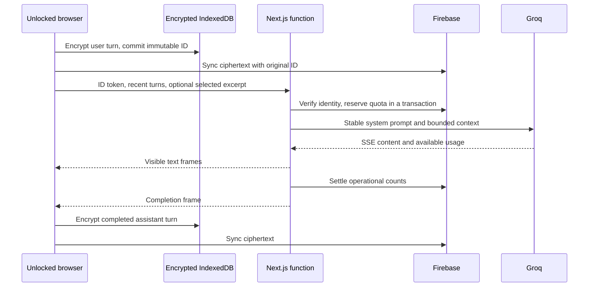

# OVI conversational architecture

Start with `components/talk/use-conversation.ts`. Follow one press of Send through `lib/conversations/repository.ts`, `app/api/ai/chat/route.ts`, then `lib/server/quota.ts`. The UI owns the unlocked draft. The route owns identity verification, provider access and spending decisions.

An upstream rejection leaves the original user turn available for an explicit retry. An unfinished assistant response stays transient. Cloud retries replay ciphertext only. The Firestore listener decrypts the latest 32 messages after unlock. Earlier pages are loaded with a snapshot cursor. Opening Talk starts a fresh conversation in memory. Its first message creates the encrypted history entry. The collapsible History list groups conversations by their creation date in the reader’s local time zone and loads older headers in pages of 24. Selecting an entry resumes that thread. Untitled legacy conversations remain accessible by date and time. An encrypted local queue keeps unsynced chats available on their original device.

The welcome and conversation views share the composer, artwork and Vault guard. The active layout gives the scroll region the space left after the composer is measured by CSS. The account avatar opens usage and Vault controls. Screenshots under `screenshots/` use synthetic text and an emulator account.

## Reading guide

| Question | Implementation and guide |
| --- | --- |
| What is OVI instructed to say? | [Personality](OVI_SYSTEM_PROMPT.md) |
| Which personal text reaches Groq? | [Context selection](OVI_CONTEXT_MANAGEMENT.md) |
| How do I configure Netlify? | [Groq and Firebase setup](OVI_GROQ_INTEGRATION.md) |
| What is counted and refunded? | [Quota transactions](OVI_RATE_LIMITING.md) |
| What happens to a photograph? | [Encrypted media](OVI_FIREBASE_MEDIA_QUOTAS.md) |
| How do I reproduce the checks? | [Research and testing](OVI_RESEARCH_NOTES.md) |
