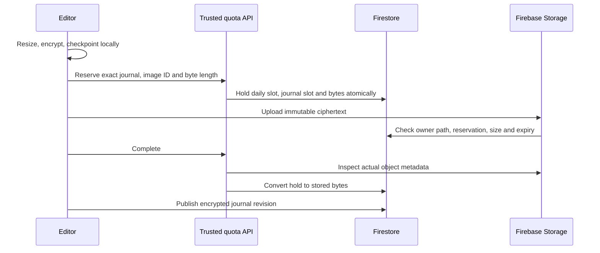

# Encrypted journal photos

`lib/media/prepare-photo.ts` decodes supported images locally and bounds the longest side to 2,000 pixels. Re-encoding removes source metadata and saves a still image, including for animated inputs. A small PNG with only the permitted image chunks can be retained directly. Existing stored files and the Vault envelope remain readable. The server limit applies to the **serialized encrypted object**, including base64 overhead.

Defaults are 20 uploads per UTC day, 20 images per journal, 5 MiB per encrypted object and 250 MiB per user. The daily, per-journal and total-storage settings are `OVI_PHOTOS_DAILY`, `OVI_PHOTOS_PER_JOURNAL` and `OVI_PHOTO_STORAGE_BYTES`. Each new immutable image ID takes an upload slot. Updating a tape note or moving an existing photo is a journal edit.

On first use, the server streams bucket metadata for the account and journal to initialize counters from pre-existing objects. New writes require an issued reservation. An account's first inventory can be slower for a large pre-beta collection. Holds reserve capacity immediately. A completion confirms actual bytes. Opening account usage or requesting another reservation reconciles expired ten-minute holds, checking for an object before refunding the original day. Retrying an acknowledged upload verifies the existing ciphertext. Upload bytes and captions never enter an AI request.

If an image quota is reached, the cloud journal can advance with the text and available images. The full encrypted local checkpoint remains pending, including the new image's position and note. The photo rejoins the cloud revision when capacity returns. Revision conflicts still preserve separate local branches.

Removal is queued locally before publishing the new revision. Cleanup reopens the latest cloud draft with the Vault key and checks whether it still references the image. The server verifies ownership and revision, marks deletion in Firestore, deletes the exact Storage generation and then releases bytes and the image slot. Daily upload spend remains. Queues retry on synchronization after reconnect or reopening. An inactive device may leave a pending deletion until it returns.
