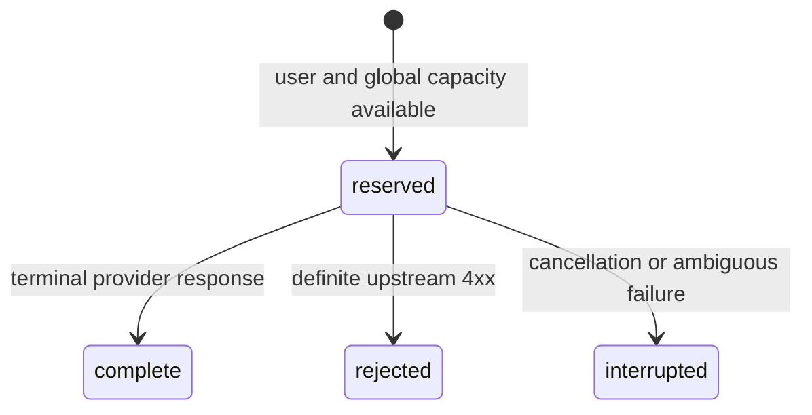

# Quota admission and reconciliation

`lib/server/quota.ts` updates the user, global window, UTC-day documents and one request ticket in a single Firestore transaction. All application instances contend on the same small global document. This serialization suits a low-throughput beta. At higher request rates, measure Firestore transaction retries and latency before raising caps or moving admission to a distributed rate limiter.

| Policy | Default or configuration |
| --- | --- |
| Chat per UTC day | 30, configured by OVI_CHAT_DAILY |
| Requests per rolling minute per user and modality | 3, configured by OVI_CHAT_BURST |
| Active requests per user | One chat and one transcription independently |
| Voice seconds per UTC day | 600, configured by OVI_VOICE_DAILY_SECONDS |
| Shared request and token limits | Required deployment settings in the integration guide |
| Shared concurrent requests | 3, configured by OVI_ORG_CONCURRENCY |
| Recording limit | 120 seconds, validated from real PCM samples |

A request ID is hashed with verified UID and modality. A repeated ID cannot start another generation. Rolling windows and active leases survive the UTC day boundary. Daily usage belongs to the admission date, even when completion comes after midnight.

Admit chat against estimated input plus the maximum completion allowance. Settle against reported input and output, subtracting reported cached input for counted tokens. Track input and output independently. Definite rejection refunds user chat or voice allowance and reserved tokens. Every attempted provider request still counts toward burst and shared request budgets. An interrupted stream with no reported usage keeps the estimated cost in the budget. A provider 429 sets a shared cooldown and the HTTP Retry-After header.

The 120-second concurrency lease outlasts the chat and voice upstream deadlines. A terminated function cannot hold the service indefinitely. Unsettled reservations retain their conservative charge. Configure a Firestore TTL policy on `quotaReservations.expiresAt` to remove old tickets after their seven-day audit window. TTL cleanup does not release active budget.

Users see their own summary through the authenticated account endpoint. Direct client access to operational documents is denied by the catch-all Firestore rule. Journal text saves never enter quota admission.
